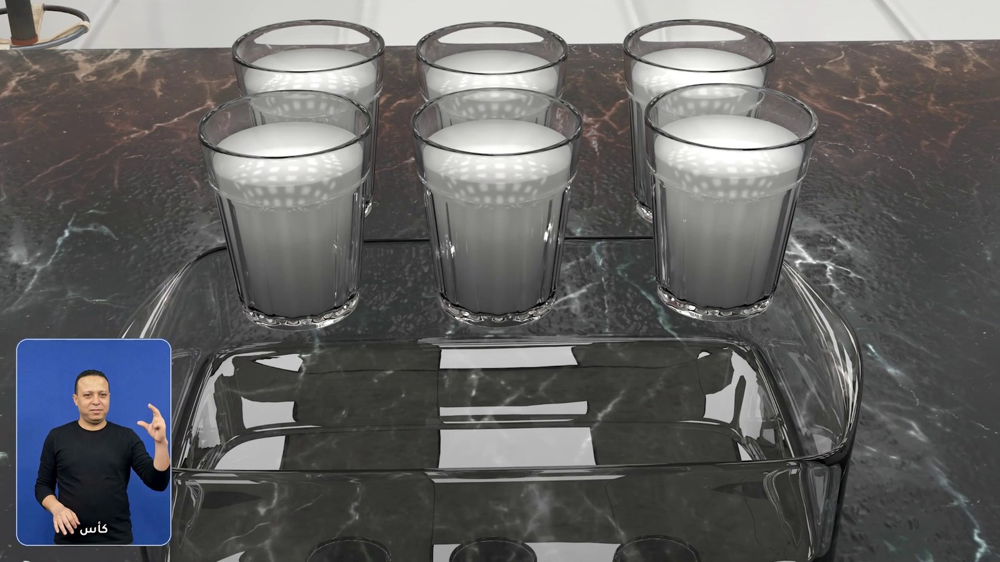
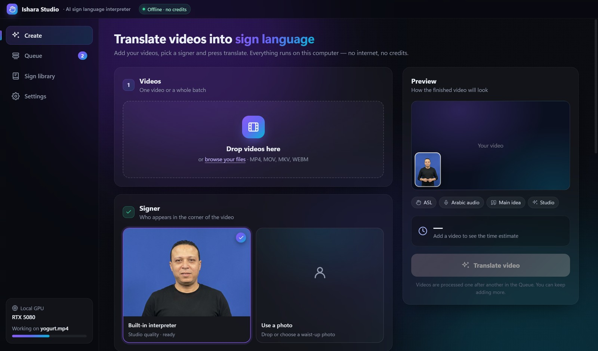
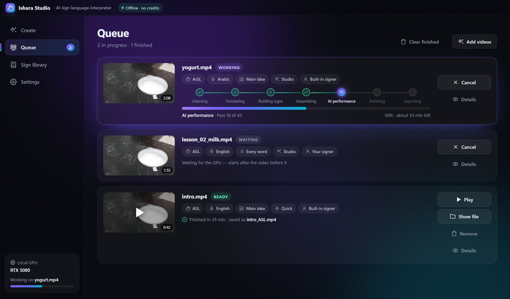
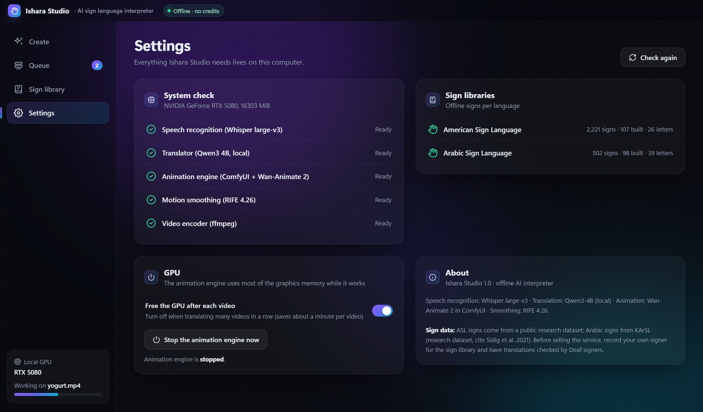
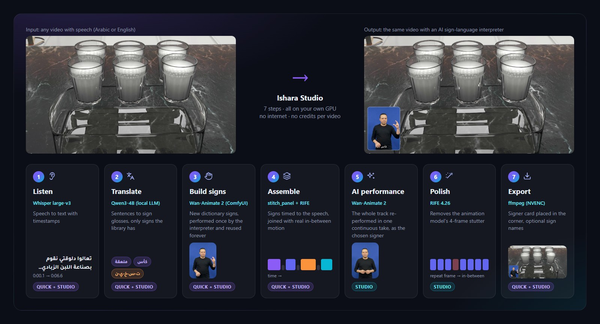
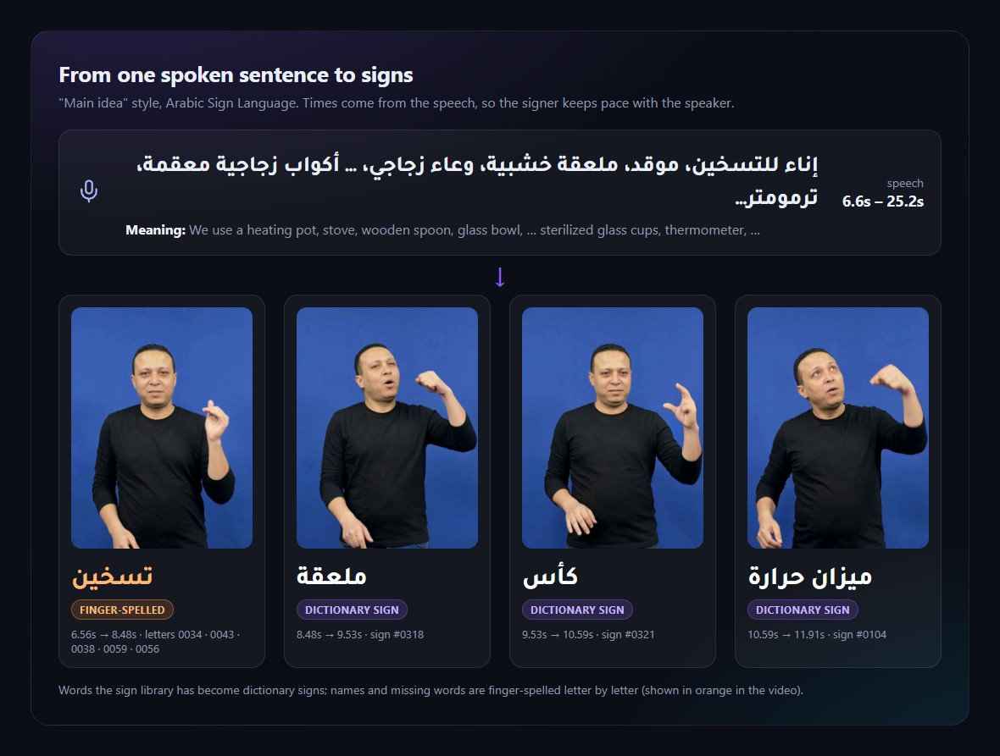
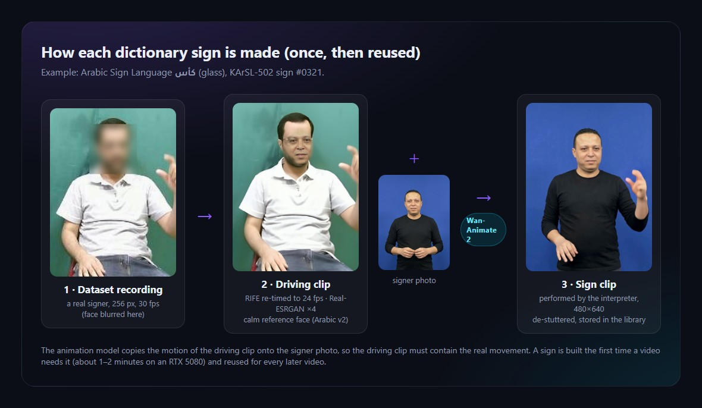
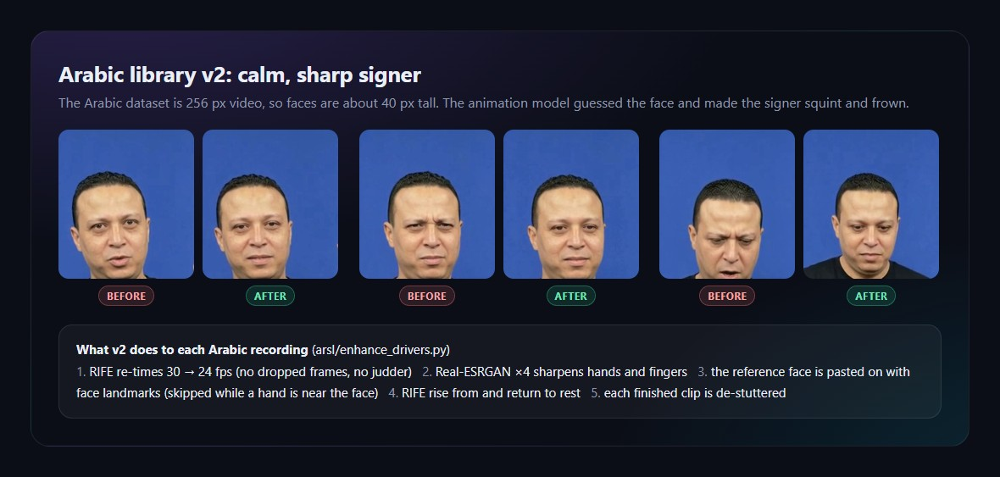
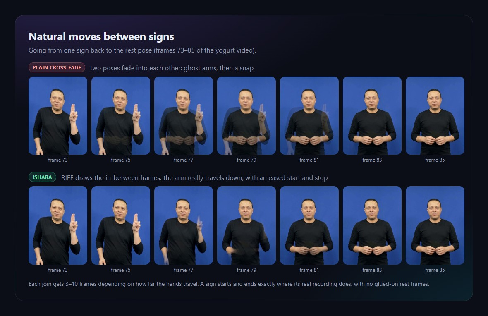

# Ishara Studio

**An offline AI sign-language interpreter for videos.** Ishara Studio listens to a video, translates the speech into
sign language and adds an AI interpreter in the corner of the picture. Everything runs on your own computer and GPU:
no internet connection, no cloud service and no cost per video.



- **Two sign languages:** American Sign Language (ASL) and unified Arabic Sign Language (ArSL, used in Egypt and across
  the Arab world).
- **Arabic or English speech**, detected automatically or chosen by you.
- **Two translation styles:** *Main idea* signs the meaning of each sentence at a calm, natural pace; *Every word* is
  complete but faster.
- **Two quality levels:** *Quick* (minutes) and *Studio* (one continuous AI performance, about 45 s of GPU time per
  second of video).
- **Any signer:** use the built-in interpreter, or drop in a waist-up photo of any person.
- **Batch queue:** add many videos; they are processed one after another and the queue survives restarts.

> Ishara (إشارة) means "sign" in Arabic.

---

## Contents

1. [The app](#the-app)
2. [How it works](#how-it-works)
3. [From speech to signs](#from-speech-to-signs)
4. [The sign library](#the-sign-library)
5. [Natural motion](#natural-motion)
6. [Quick vs Studio](#quick-vs-studio)
7. [System requirements](#system-requirements)
8. [Install: offline package](#install-offline-package)
9. [Install: from source](#install-from-source)
10. [Command line](#command-line)
11. [Project structure](#project-structure)
12. [Limitations and responsible use](#limitations-and-responsible-use)
13. [Credits and licenses](#credits-and-licenses)

---

## The app

**Create:** drop videos, choose the signer, the sign language, the spoken language, the style and the quality, then
press *Translate video*. The preview shows where the interpreter will sit and how long the job will take.



**Queue:** every video shows its seven steps, live progress and time left. Finished videos can be played or opened
in their folder. Cancel, retry and remove work at any time.



**Settings:** a health check of every local component (speech recognition, translator, animation engine, motion
smoothing, video encoder), the sign libraries, and a button that frees the GPU when you need it for other work.



A step-by-step user guide is in [app/README.md](app/README.md).

---

## How it works



| # | Step | What happens | Tool | Code |
|---|---|---|---|---|
| 1 | Listen | Speech to text with word timings | Whisper large-v3 (faster-whisper) | [`transcribe.py`](transcribe.py) |
| 2 | Translate | Each sentence becomes a sequence of signs, using only signs the library has; missing words are finger-spelled | Qwen3-4B-Instruct (local) | [`gloss_llm.py`](gloss_llm.py) |
| 3 | Build signs | Signs used for the first time are animated once as the built-in interpreter and kept for every later video | Wan-Animate 2 in ComfyUI | [`animate_signs.py`](animate_signs.py), [`polish_clips.py`](polish_clips.py) |
| 4 | Assemble | Every sign is timed against the speech, the clips are joined, and the joins get real in-between motion | OpenCV, RIFE 4.26 | [`build_track.py`](build_track.py), [`stitch_panel.py`](stitch_panel.py), [`inbetween.py`](inbetween.py) |
| 5 | AI performance *(Studio)* | The whole track is re-performed in one continuous take, as the chosen signer | Wan-Animate 2 | [`smooth_panel.py`](smooth_panel.py) |
| 6 | Polish *(Studio)* | The animation model's 4-frame stutter is replaced by learned in-between frames | RIFE 4.26 | [`destutter.py`](destutter.py) |
| 7 | Export | The signer card is placed in the chosen corner, with optional sign names | ffmpeg (NVENC) | [`engine.py`](engine.py) |

The desktop app ([`app/`](app), Electron) only starts the engine ([`engine.py`](engine.py)) and shows its progress.
The engine prints one JSON event per line (`stage`, `progress`, `transcript`, `glosses`, `done`, ...), so it can also
be driven from scripts or another front end.

---

## From speech to signs



- The translator writes **sign glosses**, not word-for-word translations. It follows the grammar of the target sign
  language (for ASL: time first, topic before comment, no articles) and may only use signs that exist in the offline
  library.
- **Main idea** keeps about one sign per second of speech, so the signer stays calm and in step with the speaker.
  **Every word** signs everything and speeds up (up to 1.6x) when the speaker is fast.
- Words the library does not have, such as names, are **finger-spelled** letter by letter. Their labels are orange
  in the video.
- The signs of a sentence start when the sentence starts and are stretched or sped up to fit it, so the
  interpreter stays in step with the speaker ([`build_track.py`](build_track.py)).
- With *Review the translation before rendering* switched on, the app pauses after step 2 so you can check and edit the signs before the
  video is rendered.

---

## The sign library



Every sign is a short **driving clip**: a real person performing the sign. The animation model (Wan-Animate 2) copies
that motion onto the signer photo and produces a **sign clip** of the interpreter. A sign is built the first time a
video needs it, in about 1–2 minutes on an RTX 5080, and is then reused by every later video.

| Library | Source recordings | Signs available | Folder (drivers → clips) |
|---|---|---|---|
| ASL | ASL video dataset on Hugging Face ([`asl/build_library.py`](asl/build_library.py)) | 2,221 words + 26 letters | `drive/` → `clips/` |
| ArSL | KArSL-502, the Arabic Sign Language dictionary ([`arsl/build_library.py`](arsl/build_library.py)) | 502 signs incl. 39 letters and numbers | `arsl/drive/` → `arsl/drive_v2/` → `arsl/clips_v2/` |

### Arabic library v2

KArSL is only available as 256 × 256 px video, so the signer's face is about 40 px tall and the animation model
had to guess it. The result was a squinting, frowning interpreter and slightly jumpy motion.
[`arsl/enhance_drivers.py`](arsl/enhance_drivers.py) prepares every Arabic recording before it is animated:



1. **RIFE re-timing** from 30 to 24 fps, using new in-between frames instead of dropping frames (no judder).
2. **Real-ESRGAN x4** upscaling, so hands and fingers are sharp.
3. **Calm face:** the reference face is placed on the recording using face landmarks (YuNet). This is skipped
   while a hand is near the face, so signs made at the face stay intact.
4. **RIFE rise and return** between the rest pose and the sign.
5. Each finished clip is **de-stuttered** ([`polish_clips.py`](polish_clips.py)).

The original drivers stay in `arsl/drive/`. The engine builds the enhanced version of any missing sign automatically.

### Recording your own signer

For production, record your own signer (ideally a Deaf native signer) once per sign. Follow
[RECORDING_GUIDE.md](RECORDING_GUIDE.md) (English and Arabic). [`split_signs.py`](split_signs.py) cuts one phone
recording of many signs into one driving clip per sign.

---

## Natural motion



- **Joins:** the stitcher plays only the real recording of each sign and leaves a short window between signs
  (3–10 frames, longer for bigger moves). [`inbetween.py`](inbetween.py) fills that window with RIFE in-between
  frames on an eased curve, so the arms actually travel from one pose to the next instead of fading or jumping.
- **Stutter:** Wan-Animate draws motion in blocks of 4 frames, and the 4th frame often repeats the 3rd. This
  looks like 18 fps shown at 24. [`destutter.py`](destutter.py) replaces only those repeated frames with RIFE
  in-betweens, and keeps a frame whenever the hands would shrink in the in-between.
- **Long renders:** Studio quality renders in fresh, aligned 81-frame passes that overlap and are blended together.
  It does not chain passes, because chaining makes the face and background drift.

---

## Quick vs Studio

| | Quick | Studio |
|---|---|---|
| What you get | The sign clips joined with smooth in-between motion | One continuous AI performance of the whole track, polished |
| Signer | Built-in interpreter | Built-in interpreter or **any photo** |
| Time for a 2-minute video* | under 1 minute | about 1.5 hours of GPU time |
| Best for | Drafts, checking the translation, long batches | Final delivery |

\* RTX 5080 16 GB, with all needed signs already in the library. Each new sign adds about 1–2 minutes the first time.

---

## System requirements

| | Minimum | Tested |
|---|---|---|
| OS | Windows 10 / 11, 64-bit | Windows 11 Pro |
| GPU | NVIDIA RTX with 16 GB VRAM | GeForce RTX 5080 16 GB |
| NVIDIA driver | supports CUDA 13 (R580 or newer) | 610.88 |
| RAM | 32 GB (64 GB recommended) | 128 GB |
| Disk | 45 GB free (models + libraries) | |

Speech recognition runs on the CPU when the CUDA 12 libraries that faster-whisper needs are missing (the normal
case with the CUDA 13 setup above); it is still faster than real time on a modern CPU.

The GPU can be shared with other programs. Before Ishara Studio starts its own GPU-heavy step it frees any memory
it no longer needs, and *Settings → Stop the animation engine now* unloads it completely.

---

## Install: offline package

The offline package is one folder that contains everything: the app, both Python environments, ComfyUI, all AI
models and both sign libraries. It needs no internet connection, no installer and no administrator rights.

1. Copy the `IsharaStudio` folder to a fast local drive with enough space, for example `D:\IsharaStudio`. Use a
   short path without special characters. Do not use *Program Files*, because the app writes its work files into
   the folder.
2. Double-click **`Ishara Studio.cmd`**.
3. In the app, open **Settings** and check that every component shows a green tick.

The first video of a session takes about a minute longer while the models load. The package is built with
[`setup/make_offline_package.py`](setup/make_offline_package.py) (see below).

---

## Install: from source

Developer setup on Windows.

1. **Prerequisites:** Python 3.14, Node.js 20+, an NVIDIA driver with CUDA 13, and
   [ComfyUI](https://github.com/comfyanonymous/ComfyUI) (portable build, or a source install with its own `venv`).
2. **Engine environment:**
   ```powershell
   py -3.14 -m venv .venv
   .venv\Scripts\python.exe -m pip install -r requirements.txt
   ```
3. **ComfyUI environment:** install ComfyUI's own requirements (CUDA 13 PyTorch), then the extras the engine uses:
   ```powershell
   <ComfyUI>\venv\Scripts\python.exe -m pip install -r requirements-comfyui.txt
   ```
4. **Models:**

   | Model | Where | How |
   |---|---|---|
   | Wan-Animate 2 (distilled int8), UMT5-XXL, CLIP Vision H, Wan 2.1 VAE | `ComfyUI\models\...` | `python setup\download_models.py <ComfyUI>\models` |
   | RIFE 4.26 heavy | `ComfyUI\models\frame_interpolation\rife_v4.26_heavy.safetensors` | Hugging Face `Comfy-Org/frame_interpolation` |
   | Real-ESRGAN x4plus | `ComfyUI\models\upscale_models\RealESRGAN_x4plus.pth` | Real-ESRGAN releases |
   | Qwen3-4B-Instruct-2507 | any folder (set `llm` below) | Hugging Face `Qwen/Qwen3-4B-Instruct-2507` |
   | Whisper large-v3, MODNet | Hugging Face cache | downloaded automatically on first use while online |
   | YuNet face detector | `models\face_detection_yunet_2023mar.onnx` | OpenCV Zoo |

5. **Tell the engine where things are:** copy `local_paths.example.json` to `local_paths.json` and fill in your
   paths (or set `ISHARA_COMFY`, `ISHARA_LLM`, `ISHARA_FFMPEG`, `ISHARA_HF_CACHE`). See [`paths.py`](paths.py).
6. **Sign libraries** (once, while online):
   ```powershell
   .venv\Scripts\python.exe asl\build_index.py
   .venv\Scripts\python.exe asl\build_library.py
   .venv\Scripts\python.exe arsl\build_library.py
   .venv\Scripts\python.exe arsl\shape_drivers.py
   <ComfyUI python> arsl\enhance_drivers.py
   ```
   Sign clips are built automatically the first time a video needs them.
7. **The app:**
   ```powershell
   cd app
   npm install
   npm start
   ```

### Building the offline package

```powershell
.venv\Scripts\python.exe setup\make_offline_package.py D:\delivery\IsharaStudio
```

This collects the app, the libraries, a portable copy of Python, both environments, ComfyUI with only the models
the app uses, the translator, the Hugging Face cache entries and ffmpeg into one folder, then writes the launcher.
On the same drive, large files are added as hard links, so building takes seconds and almost no extra space.
Copying the folder to another drive copies the real files.

---

## Command line

```text
python engine.py status                         components + sign libraries (JSON)
python engine.py probe <video> <thumb_dir>      duration, size, thumbnail
python engine.py prep-signer <photo> <out_dir>  photo -> framed signer reference (+ tips)
python engine.py library <asl|arsl>             signs in a library
python engine.py run <job.json>                 translate one video
python engine.py stop-gpu                       unload / stop the animation engine
```

A job file:

```json
{
  "id": "demo", "video": "D:\\videos\\lesson.mp4", "work": "D:\\work\\lesson", "out_dir": "D:\\videos\\signed",
  "sign_lang": "arsl", "video_lang": "ar", "style": "meaning", "quality": "studio",
  "signer": "builtin", "position": "bottom-left", "size": "medium", "labels": true, "review": false
}
```

The output is `<video>_ASL.mp4` or `<video>_ArSL.mp4`. [`run_pipeline.ps1`](run_pipeline.ps1) is the older
PowerShell driver used during development.

---

## Project structure

```text
signpipe/
├─ engine.py            the offline engine: one job = listen → translate → signs → assemble → (perform → polish) → export
├─ paths.py             where the tools and models are (offline package, environment variables or local_paths.json)
├─ transcribe.py        1  speech → text with word timings (faster-whisper)
├─ gloss_llm.py         2  sentences → sign glosses (Qwen3-4B, constrained to the library)
├─ animate_signs.py     3  driving clip + signer photo → sign clip (Wan-Animate 2 through ComfyUI's API)
├─ polish_clips.py      3  de-stutter freshly built sign clips
├─ build_track.py       4  time every sign against the speech → signtrack.json
├─ stitch_panel.py      4  join the sign clips into one signer track, plan the join windows
├─ inbetween.py         4  fill the join windows with RIFE motion
├─ smooth_panel.py      5  Studio: re-perform the whole track in aligned passes
├─ destutter.py         6  Studio: replace the 4-frame repeats with RIFE in-betweens
├─ prep_signer.py       any photo → signer reference (cut-out, framing, checks)
├─ cutout_signer.py     portrait matting (MODNet, onnxruntime)
├─ split_signs.py       one phone recording of many signs → one driving clip per sign
├─ app/                 Ishara Studio desktop app (Electron)
├─ asl/                 ASL library tools and metadata
├─ arsl/                Arabic library tools, metadata (signs.json) and the v2 enhancer
├─ setup/               model download, ComfyUI workflow, offline package builder
├─ signer/              built-in interpreter reference and the card mask/border
├─ fonts/               Tajawal (sign names in Arabic and Latin script)
├─ models/              small helper models (YuNet face detector)
└─ docs/images/         pictures used in this README
```

---

## Limitations and responsible use

- **Not a replacement for human interpreters** in medical, legal, emergency or other critical situations.
- **Translation quality:** sign languages have their own grammar, facial grammar and regional variants. Have the
  output reviewed by Deaf signers before publishing. The app's review step helps with this.
- **Dictionary signs only:** signs come from a fixed library. Classifiers, role shift and other spatial grammar are
  not generated, and missing words are finger-spelled.
- **AI artefacts:** fast hand movements can blur, and hands that cross the face are the hardest cases.
- **Datasets:** the bundled libraries are built from research datasets (see below). Check their terms before any
  commercial use, and ideally replace them with recordings of your own signer ([RECORDING_GUIDE.md](RECORDING_GUIDE.md)).
- **Signer likeness:** only use photos of people who agreed to appear as the interpreter.

---

## Credits and licenses

Ishara Studio stands on these open projects. Full notices are in [THIRD_PARTY_NOTICES.md](THIRD_PARTY_NOTICES.md).

| Component | Use | License |
|---|---|---|
| [Wan-Animate 2](https://huggingface.co/Comfy-Org/Wan-Animate-2) (Wan 2.2 Animate) | animation model | Apache-2.0 |
| [ComfyUI](https://github.com/comfyanonymous/ComfyUI) | runs the animation and frame-interpolation models | GPL-3.0 (separate program, used through its HTTP API) |
| [Qwen3-4B-Instruct-2507](https://huggingface.co/Qwen/Qwen3-4B-Instruct-2507) | translator | Apache-2.0 |
| [Whisper large-v3](https://github.com/openai/whisper) / [faster-whisper](https://github.com/SYSTRAN/faster-whisper) | speech recognition | MIT |
| [RIFE](https://github.com/hzwer/Practical-RIFE) 4.26 | in-between frames | MIT |
| [Real-ESRGAN](https://github.com/xinntao/Real-ESRGAN) | upscaling Arabic recordings | BSD-3-Clause |
| [YuNet](https://github.com/opencv/opencv_zoo) | face landmarks | MIT |
| [MODNet](https://github.com/ZHKKKe/MODNet) | cutting the signer out of a photo | Apache-2.0 |
| [Electron](https://www.electronjs.org/) | desktop app | MIT |
| [FFmpeg](https://ffmpeg.org/) | video encoding | LGPL/GPL |
| [Tajawal](https://fonts.google.com/specimen/Tajawal) | sign names | SIL OFL 1.1 |
| KArSL-502 (Sidig, Luqman, Mahmoud, Mohandes, 2021; [Hugging Face copy](https://huggingface.co/datasets/sondosafify/KArSL-502)) | Arabic Sign Language recordings | research dataset, terms by its authors |
| ASL video dataset ([Hugging Face](https://huggingface.co/datasets/shpouladi/American-Sign-Language-Dataset)) | ASL recordings | see the dataset card |

**License for Ishara Studio's own code:** not chosen yet. Add a `LICENSE` file before publishing.
